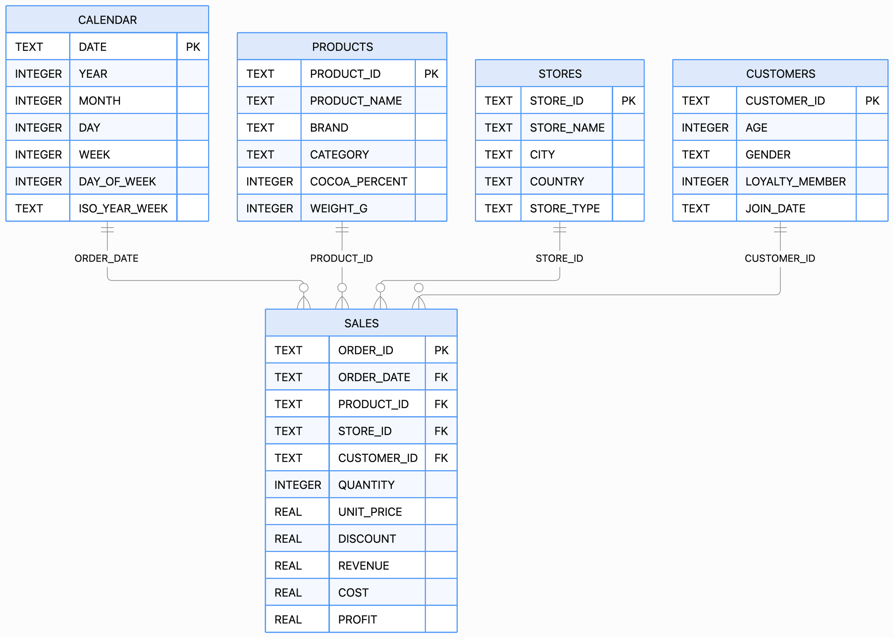

# Chocolate Sales Dashboard

## Présentation du projet

Ce projet consiste en la conception et au développement d'une application interactive d'analyse des performances commerciales d'une activité de vente de chocolat.

L'objectif est de proposer un outil permettant à la fois de **suivre les principaux indicateurs de performance** et d'**explorer librement les données grâce à un assistant d'intelligence artificielle**.

Le projet repose sur trois composantes principales :

- la construction d'une base de données relationnelle avec SQLite ;
- le développement d'un dashboard interactif avec Streamlit et Plotly ;
- l'intégration d'un assistant IA permettant d'interroger les données en langage naturel et de générer des analyses à la demande.

Cette approche vise à associer les avantages d'un reporting structuré à la flexibilité d'une exploration conversationnelle des données.

---

## Problématique

Les tableaux de bord traditionnels permettent de suivre efficacement les indicateurs définis lors de leur conception.

Cependant, lorsqu'un utilisateur souhaite approfondir une analyse ou poser une question qui n'a pas été anticipée, il doit généralement effectuer de nouvelles manipulations ou solliciter une personne maîtrisant les outils d'analyse.

L'objectif de ce projet est donc de répondre à deux besoins complémentaires :

**1. Suivre les performances commerciales**

Mettre à disposition une interface permettant de consulter les principaux indicateurs de ventes et d'explorer les performances selon différentes dimensions.

**2. Faciliter l'exploration des données**

Permettre à l'utilisateur de poser directement ses questions en langage naturel, sans avoir à maîtriser SQL ou Python.

---

## Source des données

Les données utilisées proviennent du jeu de données public **Chocolate Sales Dataset 2023–2024**, disponible sur Kaggle.

[Consulter le dataset original sur Kaggle](https://www.kaggle.com/datasets/ssssws/chocolate-sales-dataset-2023-2024)

Le dataset contient plusieurs fichiers décrivant les transactions commerciales, les produits, les points de vente, les clients et le calendrier.

Ces différentes sources ont été restructurées dans une base de données relationnelle SQLite afin de disposer d'une architecture adaptée aux analyses multidimensionnelles.

---

## Construction de la base de données

### Modélisation relationnelle

Les données initialement réparties dans plusieurs fichiers CSV ont été intégrées dans une base de données **SQLite3**.

La base est organisée autour d'une table centrale `SALES`, contenant les transactions, reliée à quatre tables descriptives :

| Table | Rôle |
|---|---|
| `SALES` | Transactions et indicateurs financiers |
| `PRODUCTS` | Informations et caractéristiques des produits |
| `STORES` | Points de vente et informations géographiques |
| `CUSTOMERS` | Caractéristiques des clients |
| `CALENDAR` | Dimensions temporelles |

Cette organisation permet d'analyser les ventes selon plusieurs axes sans dupliquer les informations descriptives dans la table transactionnelle.

### Schéma de la base de données

La table `SALES` constitue le cœur du modèle. Chaque transaction peut ainsi être enrichie par jointure avec :

- `PRODUCTS` via `PRODUCT_ID` ;
- `STORES` via `STORE_ID` ;
- `CUSTOMERS` via `CUSTOMER_ID` ;
- `CALENDAR` via `ORDER_DATE`.

Cette structure facilite la réalisation de requêtes SQL combinant plusieurs dimensions, par exemple pour analyser le chiffre d'affaires d'une catégorie de produits par pays et par période.

### Création et alimentation de la base

La base de données a été construite en Python avec `sqlite3` et `pandas`.

Le processus comprend :

1. la création des cinq tables ;
2. la définition des clés primaires et étrangères ;
3. l'importation des fichiers CSV dans les tables correspondantes ;
4. l'enrichissement de la dimension temporelle ;
5. l'exploitation de la base par requêtes SQL pour alimenter l'application.

Une variable supplémentaire permettant le regroupement par année et semaine a notamment été ajoutée à la table `CALENDAR`.

La base SQLite devient ainsi la **source structurée utilisée par l'application**, plutôt que de travailler directement sur les différents fichiers CSV.

---

## Dashboard interactif

L'application développée avec Streamlit permet de visualiser et d'explorer les performances commerciales à travers différents indicateurs et graphiques interactifs.

Les principales mesures disponibles dans la table `SALES` comprennent :

- le chiffre d'affaires (`REVENUE`) ;
- les quantités vendues (`QUANTITY`) ;
- les coûts (`COST`) ;
- le profit (`PROFIT`) ;
- les remises (`DISCOUNT`).

Grâce au modèle relationnel, ces indicateurs peuvent être analysés selon différentes dimensions : période, produit, catégorie, marque, magasin, pays ou profil client.

Le dashboard constitue ainsi la première couche d'exploration de l'application : les indicateurs essentiels sont immédiatement disponibles et les filtres permettent d'adapter l'analyse au périmètre étudié.

---

## Assistant IA : analyse en langage naturel

Une seconde couche d'analyse permet à l'utilisateur d'interroger directement les données en langage naturel.

L'objectif est de permettre des analyses qui n'ont pas nécessairement été anticipées lors de la conception du dashboard, sans obliger l'utilisateur à écrire lui-même du SQL ou du Python.

Il peut par exemple demander :

> Quels sont les produits qui génèrent le plus de chiffre d'affaires ?

> Quelle est l'évolution mensuelle du profit ?

> Quels pays contribuent le plus aux ventes ?

> Quelles catégories de produits présentent les meilleures performances ?

### Fonctionnement

L'assistant suit plusieurs étapes.

**1. Compréhension de la demande**

La question est analysée afin d'identifier les indicateurs, dimensions, filtres et regroupements nécessaires.

**2. Construction d'un plan d'analyse**

L'assistant détermine les opérations nécessaires pour répondre à la question à partir des données disponibles.

**3. Exécution**

Les données sont interrogées et traitées afin de produire le résultat demandé.

**4. Génération d'une visualisation**

Lorsque la question s'y prête, une visualisation Plotly peut être générée dynamiquement à partir du résultat obtenu.

Le graphique n'est donc pas nécessairement prédéfini dans le dashboard : sa construction dépend de la question posée.

**5. Interprétation**

L'utilisateur peut ensuite demander une interprétation des résultats calculés afin d'en obtenir une lecture synthétique et de faire ressortir les principaux enseignements.

---

## Dashboard et assistant : deux approches complémentaires

| Dashboard | Assistant IA |
|---|---|
| Indicateurs prédéfinis | Questions libres |
| Visualisations préparées | Visualisations générées à la demande |
| Exploration par filtres | Exploration en langage naturel |
| Suivi régulier des performances | Analyses ponctuelles |
| Lecture immédiate | Exploration approfondie |

Le dashboard répond aux besoins de suivi récurrents, tandis que l'assistant permet d'approfondir librement une problématique spécifique.

---

## Technologies utilisées

| Technologie | Utilisation |
|---|---|
| Python | Développement de l'application |
| Pandas | Préparation et manipulation des données |
| SQL | Interrogation, jointures et agrégations |
| SQLite3 | Base de données relationnelle |
| Streamlit | Interface interactive |
| Plotly | Visualisations interactives et dynamiques |
| OpenAI API | Compréhension et analyse en langage naturel |

---

## Compétences mobilisées

Ce projet combine plusieurs dimensions d'un projet data :

**Data Engineering**
- structuration de données issues de plusieurs fichiers ;
- conception d'une base relationnelle ;
- création et alimentation de tables SQLite ;
- définition des relations entre les données.

**Data Analysis**
- exploration des données ;
- création d'indicateurs commerciaux ;
- analyses multidimensionnelles ;
- interrogation SQL.

**Data Visualization**
- conception d'un dashboard ;
- création de graphiques interactifs ;
- restitution visuelle des performances.

**Développement**
- création d'une application Streamlit ;
- gestion des interactions utilisateur ;
- gestion de l'état de l'application ;
- articulation entre données, analyses et interface.

**Intelligence artificielle**
- intégration d'un modèle de langage ;
- interprétation de questions en langage naturel ;
- construction de plans d'analyse ;
- génération dynamique de visualisations ;
- interprétation textuelle des résultats.

---

## Limites et perspectives

Plusieurs évolutions pourraient prolonger ce projet :

- renforcer les contrôles appliqués aux requêtes et analyses générées ;
- améliorer la gestion du contexte entre plusieurs questions ;
- connecter l'application à une base de données distante ;
- intégrer de nouvelles sources de données ;
- gérer des volumes de données plus importants ;
- enrichir les capacités analytiques de l'assistant ;
- intégrer des fonctionnalités prédictives ;
- automatiser la génération de rapports.

---

## Conclusion

Ce projet couvre une chaîne complète d'exploitation de données :

**données brutes → modélisation relationnelle → SQL → analyse → visualisation → interrogation en langage naturel.**

La base SQLite fournit une structure commune aux différentes analyses. Le dashboard permet ensuite de suivre les principaux indicateurs, tandis que l'assistant IA offre une couche d'exploration supplémentaire pour répondre à des questions qui n'ont pas été anticipées lors de la conception de l'interface.

Le projet illustre ainsi la complémentarité entre **modélisation de données, SQL, analyse, visualisation et intelligence artificielle** dans la construction d'un outil d'aide à l'analyse.
